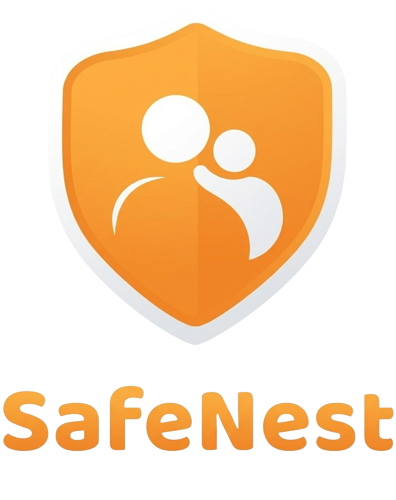

<p align="center">
  
</p>

<h1 align="center">Tuteliq Swift SDK</h1>

<p align="center">
  <strong>Official Swift SDK for the Tuteliq API</strong><br>
  AI-powered child safety analysis for iOS, macOS, tvOS, and watchOS
</p>

<p align="center">
  <a href="https://github.com/Tuteliq/swift/actions"></a>
  
  
  <a href="https://github.com/Tuteliq/swift/blob/main/LICENSE"></a>
</p>

<p align="center">
  <a href="https://docs.tuteliq.ai">API Docs</a> •
  <a href="https://tuteliq.ai">Dashboard</a> •
  <a href="https://trust.tuteliq.ai">Trust</a> •
  <a href="https://discord.gg/7kbTeRYRXD">Discord</a>
</p>

---

## Overview

Tuteliq detects grooming, bullying, self-harm, fraud, radicalisation and other harms in text, voice, images, video and documents, and verifies age and identity. This package is the native Swift client: `async`/`await`, `Codable` models, no third-party dependencies.

### Key Features

- **Safety detection**: bullying, grooming, unsafe content, plus fraud and extended-harm detectors.
- **Conversation-level risk**: continuation tokens and `trajectoryRisk` for multi-turn analysis.
- **Media**: voice, image, video and PDF analysis.
- **Synthetic content**: AI-generated text, image, audio and deepfake video detection.
- **Verification**: age and identity verification sessions with the hosted flow. A fully native SwiftUI flow with NFC chip reading is available as the licensed Tuteliq Verification package.
- **Platform**: webhooks, policy and automation rules, detection settings, incidents dashboard, moderator review, audit receipts, customer-managed encryption keys, GDPR tooling.
- **Safe defaults**: automatic retries with backoff, typed errors, Keychain-backed API key storage.

---

## Installation

### Swift Package Manager

Add Tuteliq to your `Package.swift`:

```swift
dependencies: [
    .package(url: "https://github.com/Tuteliq/swift.git", from: "3.0.0")
]
```

Or in Xcode: **File → Add Package Dependencies** → Enter:
```
https://github.com/Tuteliq/swift.git
```

### Requirements

- Swift 5.9+
- iOS 15+ / macOS 12+ / tvOS 15+ / watchOS 8+ / visionOS 1+

### Migrating from 2.x

3.0.0 brings the SDK in line with the current API. Most apps need a few small edits. The old names below still compile, with a deprecation warning that names the replacement.

| 2.x | 3.0.0 |
|---|---|
| `RecommendedAction.flagForModerator` | `.flagForReview` (deprecated alias kept) |
| `DocumentType.idCard` | `.nationalId` (deprecated alias kept) |
| `updatePolicy(_:)` | `setPolicy(_:)` (deprecated alias kept) |
| `recommendedAction: String` on results | `RecommendedAction`. Compare with `<` or use `RecommendedAction.strongest(_:)` instead of matching strings. |

Changes that need an edit:

- **New enum cases.** `RecommendedAction.block`, `TuteliqError.quotaExceededError`, `VerificationSessionStatus.documentRequired` and new `Language` cases were added. An exhaustive `switch` over these enums needs the new cases or a `default`.
- **`BatchItem.grooming`** gained `childAge`. Creating it is unchanged; a pattern that binds its values needs one more element: `case let .grooming(id, messages, context, childAge)`.
- **Fields with a new type**, matching what the API sends:
  - `VerificationSession.expiresAt` is `Int64`, epoch milliseconds (was `String`). `expiresAtDate` gives a `Date`.
  - `VerificationSessionResult.result` is `VerificationResult?` (was `AnyCodable?`), and `.createdAt` and `.expiresAt` are `Int64?` epoch milliseconds (were `String?`).
  - `PolicyResult.config`, `PolicyResult.message` and `UsageQuotaResult.apiKeyId` are optional, because the API can omit them. Unwrap them where you read them.
- **Removed types.** `AgeVerificationResult`, `IdentityVerificationResult` and `VideoSafetyFinding` were not returned by any 2.x call. Use `VerificationRetrieveResult`, `IdentityRetrieveResult` and `VideoAnalysisResult.frameResults` instead.
- **`LivenessChallenge.expiresAt`** is `Int64`, so it decodes on 32-bit watchOS.

---

## Quick Start

```swift
import Tuteliq

// At app launch: reads TuteliqAPIKey from Info.plist and stores it in the Keychain
try Tuteliq.configure()

// Anywhere in your app: creates a client from the Keychain-stored key
let tuteliq = try Tuteliq.withStoredAPIKey()

let result = try await tuteliq.analyze(content: "Message to check")

if result.recommendedAction.isActionable {
    print("Needs review: \(result.summary)")
}
```

> See [Security Best Practices](#security-best-practices) for the recommended `.xcconfig` setup.

---

## API Reference

### Initialization

```swift
// Simple
let tuteliq = try Tuteliq(apiKey: "your-api-key")

// With options
let tuteliq = try Tuteliq(
    apiKey: "your-api-key",
    timeout: 30,      // Request timeout in seconds
    maxRetries: 3,    // Attempts for transient failures (rate limits, 5xx, network)
    retryDelay: 1,    // Initial retry delay in seconds, doubled each attempt
    cacheTTL: 0       // Cache GET responses for N seconds (0 = off)
)
```

All methods are `async throws` and the client is safe to share across tasks.

### Branching on Results

Every detection result carries `recommendedAction`, an enum ordered weakest to strongest:
`.none` → `.monitor` → `.flagForReview` → `.block` → `.immediateIntervention`.

```swift
let result = try await tuteliq.detectBullying(content: message)

switch result.recommendedAction {
case .immediateIntervention: escalate()
case .block: hide(message)
case .flagForReview: queueForModerator(message)
case .monitor, .none: break
}

// Or simply:
if result.recommendedAction.isActionable { /* .flagForReview or stronger */ }
```

Branch on `recommendedAction`, not on `isBullying` / `unsafe` / `groomingRisk == .low`: those fire on monitor-only signals and will over-alert. `actionDetail` is human-readable text for a moderator UI; don't branch on it.

### Common Parameters

#### Tracking Fields

Most inputs accept `externalId`, `customerId` and `metadata`. They're echoed back in the response and included in webhooks:

```swift
let result = try await tuteliq.detectBullying(
    DetectBullyingInput(
        content: "Test message",
        externalId: "msg_12345",       // your record ID
        customerId: "tenant_42",       // your end customer, for multi-tenant routing
        metadata: ["channel": "general"]
    )
)
print(result.externalId)  // "msg_12345"
```

`incidentModerationEnabled` overrides your account's incident-logging setting for one call: `false` suppresses persistence (e.g. test traffic), `true` forces it, `nil` uses the account default.

#### Context

```swift
let context = AnalysisContext(
    language: "en",
    ageGroup: "11-13",
    relationship: "classmates",
    platform: "MyApp",   // your app name; sent as "MyApp - Swift SDK"
    country: "GB",       // ISO 3166-1 alpha-2, localises crisis helplines
    priorMessages: [PriorMessage(role: "contact", text: "earlier message")]
)
```

`priorMessages` submits earlier turns for this call only (never stored). It's supported by `detectUnsafe` and the fraud / coercive-control / distress-signals family.

#### Support Threshold

Detection inputs accept `supportThreshold`, the minimum severity at which `result.support` carries localised crisis helplines and guidance (default `.high`; critical always includes support):

```swift
let result = try await tuteliq.detectUnsafe(
    DetectUnsafeInput(content: "I don't want to be here anymore", supportThreshold: .medium)
)
for line in result.support?.helplines ?? [] {
    print("\(line.name): \(line.number)")
}
```

#### Fast Mode

`verdictOnly: true` returns only the verdict: it drops `messageAnalysis`, `actionDetail`, and (on the fraud/extended endpoints, unless `includeEvidence` is set explicitly) `evidence`. Use it to screen live chat, then re-run flagged content in standard mode. `rationale` is always generated.

### Safety Detection

#### `detectBullying`

```swift
let result = try await tuteliq.detectBullying(content: "Nobody likes you, just leave")

print(result.severity)          // .low, .medium, .high, .critical
print(result.bullyingType)      // ["exclusion", "verbal_abuse"]
print(result.recommendedAction) // .flagForReview
print(result.rationale ?? "")
```

**Multi-turn conversations.** A single message rarely shows slow-burn exclusion. Thread the continuation token through the conversation; no message content is stored server-side:

```swift
var token: String?
for message in conversation {
    let result = try await tuteliq.detectBullying(
        DetectBullyingInput(content: message, continuationToken: token)
    )
    token = result.continuationToken

    // Branch on the higher of the per-message and conversation-level risk
    let risk = max(result.riskScore, result.trajectoryRisk ?? 0)
    print(risk, result.trajectory ?? .none, result.severitySeries ?? [])
}
```

Pass `resetConversation: true` to start over in the same session.

**Word-list flags.** `flagProfanity` and `flagRiskTerms` add deterministic `profanity` / `riskTerms` fields. They're free and additive, and never change the verdict. An explicit `true`/`false` overrides the account default; `nil` uses it.

#### `detectGrooming`

```swift
let result = try await tuteliq.detectGrooming(
    DetectGroomingInput(
        messages: [
            GroomingMessage(role: .adult, content: "This is our secret", senderAge: 34),
            GroomingMessage(role: .child, content: "Ok I won't tell", senderAge: 12),
        ],
        childAge: 12,
        participantAge: 34   // when known, e.g. on age-verified platforms
    )
)

if result.recommendedAction.isActionable {
    print("Flags: \(result.flags)")  // ["secrecy", "isolation"]
}

for m in result.messageAnalysis ?? [] {
    print("Message \(m.messageIndex): risk=\(m.riskScore), flags=\(m.flags)")
}
```

For conversations longer than ~20–30 turns, send them in windows and thread `continuationToken` between calls.

#### `detectUnsafe`

```swift
let result = try await tuteliq.detectUnsafe(content: "I don't want to be here anymore")

if result.recommendedAction.isActionable && result.categories.contains("self_harm") {
    showCrisisResources(result.support)
}
```

Supports `continuationToken` / `resetConversation`, `context.priorMessages`, `flagProfanity` and `flagRiskTerms`.

#### `analyze`

Runs bullying and unsafe detection in parallel and combines them:

```swift
let result = try await tuteliq.analyze(content: "Message to check")

print(result.riskLevel)          // .safe, .low, .medium, .high, .critical
print(result.riskScore)          // 0.0 – 1.0
print(result.recommendedAction)  // strongest of the two sub-results
print(result.summary)
```

`AnalyzeInput` forwards `verdictOnly`, `flagProfanity`, `flagRiskTerms` and `incidentModerationEnabled` to both detectors. `analyze` takes no continuation token, so for multi-turn work call the detectors directly.

### Fraud & Extended Harm Detection

All of these take a `DetectionInput` and return a `DetectionResult`:

| Method | Detects |
|--------|---------|
| `detectSocialEngineering` | Pretexting, impersonation, urgency, authority exploitation |
| `detectAppFraud` | Fake apps, malicious downloads, clone apps |
| `detectRomanceScam` | Love-bombing, financial requests, identity fabrication |
| `detectMuleRecruitment` | Easy-money offers, account sharing, laundering language |
| `detectGamblingHarm` | Underage gambling, addiction patterns, predatory odds |
| `detectCoerciveControl` | Isolation, financial control, surveillance, threats |
| `detectVulnerabilityExploitation` | Targeting of vulnerable users (cross-endpoint modifier) |
| `detectRadicalisation` | Extremist rhetoric, recruitment, dehumanisation |
| `detectDistressSignals` | Loneliness, isolation and hopelessness language, trust-seeking openers |
| `detectTFGBV` | Tech-facilitated gender-based violence: image-based abuse, stalking, doxing, deepfakes |

```swift
let result = try await tuteliq.detectRomanceScam(
    DetectionInput(
        content: "I need you to send me gift cards so I can visit you",
        context: AnalysisContext(ageGroup: "18+"),
        includeEvidence: true
    )
)

print(result.level)       // "high"
print(result.categories.map(\.tag))
for e in result.evidence ?? [] {
    print("\(e.tactic): \"\(e.text)\"")
}
```

`detectCoerciveControl`, `detectVulnerabilityExploitation` and `detectDistressSignals` are conversation-aware: they return `continuationToken` and `trajectoryRisk` like `detectBullying`.

### Multi-Endpoint Analysis

```swift
let result = try await tuteliq.analyseMulti(
    AnalyseMultiInput(
        content: "Suspicious message",
        detections: [.socialEngineering, .romanceScam, .grooming, .vulnerabilityExploitation]
    )
)

print(result.summary.highestRisk.endpoint, result.summary.highestRisk.riskScore)
print(result.crossEndpointModifier ?? 1.0)
```

Up to 10 endpoints per request. Including vulnerability exploitation applies its modifier to the other results.

### Media Analysis

Media results share the same verdict fields as text detection: `detected`, `confidence`, `recommendedAction`, `actionDetail` and `rationale`. The SDK sets each upload's MIME type from the filename (`Tuteliq.mimeType(forFilename:)`).

#### `analyzeVoice`

```swift
let result = try await tuteliq.analyzeVoice(
    AnalyzeVoiceInput(
        file: try Data(contentsOf: audioURL),
        filename: "recording.m4a",
        analysisType: .all,   // .bullying, .unsafe, .grooming, .emotions, .all
        ageGroup: "11-13"
    )
)

print(result.transcription.text)
print(result.overallSeverity)    // .none for silent or benign audio
print(result.recommendedAction)
```

Formats: mp3, wav, m4a, ogg, flac, webm, mp4 (max 25MB).

#### `analyzeImage`

```swift
let result = try await tuteliq.analyzeImage(
    AnalyzeImageInput(
        file: try Data(contentsOf: imageURL),
        filename: "screenshot.png",
        analysisType: .all,
        flagProfanity: true   // word-list check over OCR'd text
    )
)

print(result.vision.extractedText)
print(result.vision.visualCategories)
print(result.recommendedAction)
```

Formats: png, jpg, jpeg, gif, webp (max 10MB). Animated GIFs are analysed frame by frame, so send the original GIF rather than a still.

#### `analyzeVideo`

```swift
let result = try await tuteliq.analyzeVideo(
    AnalyzeVideoInput(file: try Data(contentsOf: videoURL), filename: "clip.mp4")
)

print(result.framesAnalyzed, result.durationSeconds)
print(result.categories ?? [])
for flag in result.flaggedTimestamps {
    print("\(flag.timestampSeconds)s: \(flag.reason) (\(flag.severity))")
}
```

#### `analyzeDocument`

```swift
let result = try await tuteliq.analyzeDocument(
    AnalyzeDocumentInput(
        file: try Data(contentsOf: pdfURL),
        filename: "report.pdf",
        endpoints: [.unsafe, .coerciveControl, .radicalisation]
    )
)

print(result.overallSeverity, result.flaggedPages.count, result.creditsUsed)
for page in result.pageResults {
    for endpoint in page.results where endpoint.detected {
        print("Page \(page.pageNumber) – \(endpoint.endpoint): \(endpoint.rationale)")
    }
}
```

PDF up to 50MB. Each page is analysed independently using the text layer, with OCR as a fallback. No document data is retained.

#### `voiceStream`

Real-time voice analysis over WebSocket (`URLSessionWebSocketTask`, no dependencies):

```swift
let session = tuteliq.voiceStream(
    config: VoiceStreamConfig(intervalSeconds: 10, analysisTypes: ["bullying", "unsafe"]),
    handlers: VoiceStreamHandlers(
        onTranscription: { print("Transcript: \($0.text)") },
        onAlert: { print("Alert: \($0.category) (\($0.severity))") }
    )
)

try await session.connect()
try session.sendAudio(audioData)
let summary = try await session.end()
print(summary.overallRisk, summary.transcript)
```

### Synthetic Content Detection

```swift
// Text
let text = try await tuteliq.detectSyntheticText(
    DetectSyntheticTextInput(content: "In conclusion, it is important to note…")
)
print(text.classification)  // .suspectedSynthetic

// Image: vision, EXIF, pixel statistics, C2PA, watermarks, perceptual hash
let image = try await tuteliq.detectSyntheticImage(
    DetectSyntheticMediaInput(file: jpegData, filename: "photo.jpg")
)
print(image.classification, image.metadataAnalysis.hasCamera, image.provenance?.aiTool ?? "-")

// Audio: spectral forensics
let audio = try await tuteliq.detectSyntheticAudio(
    DetectSyntheticMediaInput(file: audioData, filename: "voice.mp3")
)
print(audio.audioStats?.flatFactor ?? 0, audio.spectralSignals ?? [])

// Video: temporal face consistency + lip sync
let video = try await tuteliq.detectSyntheticVideo(
    DetectSyntheticMediaInput(file: videoData, filename: "clip.mp4", maxFrames: 10)
)
print(video.temporalConsistency?.identityConsistencyScore ?? 0, video.lipSync?.correlation ?? 0)
```

Classifications are `.confirmedSynthetic`, `.suspectedSynthetic`, `.unknown` and `.confirmedAuthentic`. Verdicts are cached for an hour by input hash. Pass `bypassCache: true` to force a fresh evaluation.

### Emotional Analysis

```swift
let result = try await tuteliq.analyzeEmotions(content: "I'm so stressed about everything")

print(result.dominantEmotions)  // ["anxiety", "sadness"]
print(result.trend)             // .improving, .stable, .worsening
print(result.recommendedFollowup)
```

### Guidance & Reports

```swift
let plan = try await tuteliq.getActionPlan(
    GetActionPlanInput(
        situation: "Someone is spreading rumors about me",
        childAge: 12,
        audience: .child,   // .child, .parent, .platform
        severity: .medium
    )
)
print(plan.steps)

let report = try await tuteliq.generateReport(
    GenerateReportInput(
        messages: [
            ReportMessage(sender: "user1", content: "Threatening message"),
            ReportMessage(sender: "child", content: "Please stop"),
        ],
        childAge: 14
    )
)
print(report.summary, report.riskLevel, report.recommendedNextSteps)
```

### Verification

Session-based age and identity verification. You create a session server-side, the user completes document capture, liveness and selfie in Tuteliq's hosted flow, and you read the result.

1. **Create a session** with `createVerificationSession`.
2. **Open `session.url`** in `ASWebAuthenticationSession`, `SFSafariViewController` or a web view. The URL carries a session token, so treat it as a secret.
3. **Poll** `getVerificationSession(id:)` until `status` is `.completed` or `.failed` (or use webhooks).
4. **Read** `result`. Extracted document fields are only included on the **first** poll after completion.

```swift
let session = try await tuteliq.createVerificationSession(
    CreateVerificationSessionInput(mode: .age, documentType: .passport)  // .passport, .nationalId, .driversLicense
)
print(session.url, session.expiresAtDate)

// Later
let status = try await tuteliq.getVerificationSession(id: session.sessionId)
if status.status == .completed, let result = status.result {
    print(result.status)                  // .verified, .failed, .needsReview
    print(result.age ?? -1, result.isMinor ?? false)
    print(result.document?.countryCode ?? "")
}

// Cancel: the session moves to .expired and staged document images are purged
_ = try await tuteliq.cancelVerificationSession(id: session.sessionId)

// Retrieve past results by verification ID
let age = try await tuteliq.getAgeVerification(id: "vrf_…")
let identity = try await tuteliq.getIdentityVerification(id: "vrf_…")
print(age.livenessValid, identity.faceConfidence ?? 0)
```

| | Age | Identity |
|---|---|---|
| Plan | Pro and above | Business, Enterprise |
| Credits | 10, charged on completion | 15, charged on completion |

### Verification Sessions in Your Own App

Everything a native capture UI needs from the API is in this SDK, so you can build your own document, liveness and selfie screens. Create the session where your API key lives (ideally your backend) and pass its `url` to the app. The app then talks to the session endpoints with the session token only.

```swift
// App side: the session link carries the session ID and token. It must be an
// https link on verify.tuteliq.ai; uploads go to https://api.tuteliq.ai.
let credentials = try VerificationSessionCredentials(sessionURL: session.url)
let api = VerificationSessionClient(credentials: credentials)

let mode = try await api.fetchMode()            // .full or .livenessOnly, language, age threshold…
await api.reportProgress(.connected)            // drives the integrator's live status

// Document: upright JPEG(s), validated in the background while the user continues.
let front = try await api.validateDocument(passportJPEG, side: .passport, documentType: .passport, captureSource: .camera)
if !front.valid { /* show front.issues.first and retake */ }

// Optional: raw files read from the document's NFC chip.
let chip = try await api.validateChip([.com: efCOM, .dg1: dg1, .sod: efSOD], documentType: .passport)  // nil if not offered

// Liveness: fetch a signed challenge (on the server's clock), run your own detection, then build the token.
var token = try await api.startLiveness()
while let prompt = token.nextChallenge {
    // Show the next prompt only once it may be recorded, so each step is recorded when it happened.
    let wait = token.earliestNextCompletion.timeIntervalSinceNow
    if wait > 0 { try await Task.sleep(nanoseconds: UInt64(wait * 1_000_000_000)) }
    let passedAt = try await waitForUser(toPerform: prompt)          // your detection
    try token.complete(prompt, at: passedAt)
}
let liveness = LivenessCapture(token: try token.encoded(), frames: keptFrames, nonce: token.challenge.nonce)

// Selfie: with the liveness capture, the server can assess liveness, age and face match now.
let selfie = try await api.validateSelfie(selfieJPEG, liveness: liveness)

// Submit only what the server doesn't already hold.
var submission = SessionSubmission(documentType: .passport)
if !front.retained { submission.documentFront = passportJPEG; submission.documentCaptureSource = .camera }
if !selfie.assessed || submission.documentFront != nil { submission.selfie = selfieJPEG; submission.liveness = liveness }
let result = try await api.submit(submission)   // .completed, .failed or .documentRequired
```

Session links:

- A link usually reaches the app from outside (a deep or universal link), so it never decides where the device uploads. `VerificationSessionCredentials` accepts only `https` links on `verify.tuteliq.ai` with no user name or password, and sends every request to `https://api.tuteliq.ai`.
- For your own deployment (staging, for example), pass it explicitly: `VerificationSessionCredentials(sessionURL: link, apiBaseURL: yourAPI)`. The override must be `https`, or `http` on `localhost`. `createVerificationCredentials` passes the client's own base URL for you.
- The `company` parameter is display text from the link, not a verified identity.
- `redirectURL` comes from the link too, so anyone can set it. When the flow ends, send the user to the redirect you configured for your account, or check `redirectURL` against it before opening it.
- The session token is a bearer credential. The credentials, the client and `LivenessCapture` print and dump with the token redacted, and errors never repeat the link.

Rules the server enforces:

- **Challenge order and timing:** complete the prompts in the order received, at least 0.55 s apart. Wait until `earliestNextCompletion` before showing the next prompt rather than recording a completion later than it happened, and never record one in the future (`complete` refuses it). Use the token within about 5 minutes (`encoded()` refuses an expired one); each nonce works once.
- **Frames:** send 2–12 upright, unmirrored JPEG frames from the liveness run. The server re-analyses them and decides; the token alone proves nothing.
- **Errors:** session problems throw `VerificationError` (`.sessionExpired`, `.rateLimited(retryAfter:)`, `.server(code:message:statusCode:)`…). On `SVC_4002`, retry the submit once after a short pause. On `ANALYSIS_6005`, recapture the document. On `.documentRequired`, add a document and submit again.

`VerificationSessionAPI` is the protocol behind `VerificationSessionClient`, for fakes in tests or your own transport.

**What `capture_context` sends.** Each upload can carry a `CaptureContext`. It is untrusted metadata asserted by the device, used to know what evidence to expect and to diagnose failed captures; no verification is decided on it. Its fields:

| Field | Contents | Why |
|---|---|---|
| `sdk` | SDK name and version, platform, OS version, hardware model (e.g. `iPhone17,1`) | Diagnosing capture problems on specific devices and versions |
| `pipeline`, `pipeline_version` | The capture pipeline, e.g. `native-ios` | Which client produced the upload |
| `face` | Camera used, on-device liveness engine and version, and for TrueDepth: verdict, frames analysed and with depth, pass rates, coverage | What liveness evidence to expect |
| `document` | Camera or file, whether it was auto-captured, on-device document check verdict, tilt range and frame count, check scores and reasons | What document evidence to expect |
| `chip` | Access protocol and key type, whether the key came from the photo, chip and active authentication outcomes, data groups read | What chip evidence to expect |

It sends no image and no raw facial measurement. `LivenessDepthEvidence`'s millimetre and distance values are measurements of a face, possibly a child's: they stay on the device and are never encoded. Leave out `capture_context` entirely if you prefer; nothing depends on it.

### Native Verification (licensed add-on)

The hosted verification flow above works with this SDK alone. For a fully native iOS flow (document capture with on-device MRZ reading, NFC passport and ID chip reading, liveness and selfie, all in SwiftUI), Tuteliq offers **Tuteliq Verification**, a separate package that builds on this one. It requires a verification license; contact [Tuteliq](https://tuteliq.ai) for access.

### Webhooks

```swift
let hook = try await tuteliq.createWebhook(
    CreateWebhookInput(
        name: "Safety Alerts",
        url: "https://example.com/webhooks/tuteliq",
        events: [.incidentCritical, .groomingDetected]
    )
)
print(hook.secret)  // shown once; store it for signature verification

let list = try await tuteliq.listWebhooks()
_ = try await tuteliq.updateWebhook(id: hook.id, UpdateWebhookInput(isActive: false))
_ = try await tuteliq.testWebhook(id: hook.id)
_ = try await tuteliq.regenerateWebhookSecret(id: hook.id)  // old secret is invalidated immediately
_ = try await tuteliq.deleteWebhook(id: hook.id)
```

### Policy Configuration

```swift
let policy = try await tuteliq.getPolicy()

// Keys use the API's camelCase names
_ = try await tuteliq.setPolicy([
    "bullying": AnyCodable(["enabled": true, "minRiskScoreToFlag": 0.5, "minRiskScoreToBlock": 0.8]),
])
```

### Policy Automation Rules

Rules apply an action automatically when a detection matches:

```swift
let created = try await tuteliq.createPolicyRule(
    CreatePolicyRuleInput(
        name: "Escalate critical grooming",
        endpoints: ["grooming"],
        conditions: PolicyRuleConditions(minSeverity: .critical),
        action: PolicyRuleAction(type: .escalate, escalateTo: "safety-team"),
        priority: 0
    )
)

let rules = try await tuteliq.listPolicyRules()
_ = try await tuteliq.updatePolicyRule(id: created.rule.id, UpdatePolicyRuleInput(enabled: false))
_ = try await tuteliq.deletePolicyRule(id: created.rule.id)

// Dry-run against a hypothetical result
let evaluation = try await tuteliq.evaluatePolicyRules(
    EvaluatePolicyRulesInput(endpoint: "grooming", riskScore: 0.92, severity: .critical, categories: ["isolation"])
)
print(evaluation.evaluation.policyAction)  // "escalate"
```

### Detection Settings

```swift
let settings = try await tuteliq.getDetectionSettings()

_ = try await tuteliq.updateDetectionSettings(
    UpdateDetectionSettingsInput(
        disabledEndpoints: ["gambling-harm"],   // or enabledEndpoints, not both
        defaultContext: DetectionDefaultContext(ageGroup: "13_17", platform: "MyApp"),
        defaultFlagProfanity: true,
        defaultFlagRiskTerms: false
    )
)

_ = try await tuteliq.resetDetectionSettings()
```

### Threat Intelligence (Business+)

```swift
let trends = try await tuteliq.getIntelligenceTrends(IntelligenceTrendsOptions(days: 30, endpoint: "grooming"))
let emerging = try await tuteliq.getEmergingThreats(days: 7)
let digest = try await tuteliq.getWeeklyDigest()
let risk = try await tuteliq.getRiskTrends(days: 30)
print(digest.summary, digest.notableChanges)
```

### Incidents & Moderator Review

```swift
// Dashboard queries, scoped to your account
let overview = try await tuteliq.getIncidentsOverview()
print("\(overview.requiresReviewCount) incidents need triage")

var cursor: String?
repeat {
    let page = try await tuteliq.listIncidents(ListIncidentsInput(severity: .critical, limit: 50, cursor: cursor))
    page.incidents.forEach { print($0.id, $0.riskCategory, $0.createdAt) }
    cursor = page.nextCursor
} while cursor != nil

let detail = try await tuteliq.getIncident(id: "inc_…")
let trends = try await tuteliq.getIncidentTrends(bucket: .day)

// EU AI Act Art 14 human oversight: each review emits a signed audit receipt
let review = try await tuteliq.reviewIncident(
    id: "inc_…",
    ReviewIncidentInput(action: .dismiss, reasonCode: .falsePositive, moderatorExternalId: "mod_jane")
)

// Same review across up to 100 incidents; failures are per-item
let batch = try await tuteliq.batchReviewIncidents(
    BatchReviewIncidentsInput(incidentIds: ["inc_1", "inc_2"], action: .resolve, reasonCode: .confirmedAccurate)
)
print("\(batch.succeeded)/\(batch.total)")
```

`moderatorExternalId` should be a stable per-moderator ID so the audit trail can attribute each decision.

### Audit Receipts & Encryption Keys

```swift
// EU AI Act Art 12: signed record of a past inference (only the producing API key can fetch it)
let receipt = try await tuteliq.getAuditReceipt(requestId: tuteliq.lastRequestId!)
print(receipt.payload.decision, receipt.signature.algorithm, receipt.canonical)

// Customer-managed encryption: incidents are encrypted with your RSA public key
_ = try await tuteliq.registerEncryptionKey(
    RegisterEncryptionKeyInput(algorithm: .rsaOaep4096, publicKeyPem: pem)
)
let key = try await tuteliq.getEncryptionKey()   // nil when none is registered
_ = try await tuteliq.revokeEncryptionKey()
```

If you lose the private key, Tuteliq cannot decrypt incidents encrypted under it. BYOK-encrypted fields on incidents are listed in `e2eEnvelopeFields`.

### Batch Analysis

```swift
let batch = try await tuteliq.batchAnalyze(
    BatchAnalyzeInput(items: [
        .bullying(id: "msg-1", text: "You're not welcome"),
        .text(id: "msg-2", type: .romanceScam, text: "Send the gift card codes"),
        .grooming(id: "conv-1", messages: groomingMessages, childAge: 12),
    ])
)

for item in batch.results where item.success && item.type == "bullying" {
    let result = try item.decodeResult(as: BullyingResult.self)
}
print(batch.summary.processingTimeMs, batch.summary.totalCreditsUsed ?? 0)
```

Up to 50 items per request.

### Account Management (GDPR)

```swift
_ = try await tuteliq.exportAccountData()                      // Art 20
_ = try await tuteliq.deleteAccountData()                      // Art 17
_ = try await tuteliq.recordConsent(RecordConsentInput(consentType: .childSafetyMonitoring, version: "1.0"))
_ = try await tuteliq.getConsentStatus(type: .childSafetyMonitoring)
_ = try await tuteliq.withdrawConsent(type: .marketing)        // Art 7.3
_ = try await tuteliq.rectifyData(RectifyDataInput(collection: "incidents", documentId: "abc", fields: ["summary": AnyCodable("Corrected")]))
_ = try await tuteliq.getAuditLogs(action: .dataExport, limit: 10)  // Art 15
```

### Breach Management (GDPR Art 33/34)

```swift
let logged = try await tuteliq.logBreach(
    LogBreachInput(
        title: "Unauthorized access", description: "…", severity: .high,
        affectedUserIds: ["user-1"], dataCategories: ["email"], reportedBy: "security-team"
    )
)
_ = try await tuteliq.listBreaches(status: .investigating)
_ = try await tuteliq.updateBreachStatus(id: logged.breach.id, UpdateBreachInput(status: .contained, notificationStatus: .usersNotified))
```

### Pricing

```swift
let plans = try await tuteliq.getPricing()         // public
let details = try await tuteliq.getPricingDetails() // authenticated
```

---

## Usage Tracking

```swift
let result = try await tuteliq.detectBullying(content: "test")
print(result.creditsUsed ?? 0)

// Monthly usage and rate limit, from response headers of the last request
if let usage = tuteliq.usage {
    print("\(usage.used)/\(usage.limit), warning: \(usage.warning ?? "none")")
}
print(tuteliq.rateLimitInfo?.remaining ?? 0)
print(tuteliq.lastRequestId ?? "", tuteliq.lastLatency ?? 0)

// Usage API
let summary = try await tuteliq.getUsageSummary()
let quota = try await tuteliq.getUsageQuota()        // -1 = unlimited
print(quota.remaining.requestsThisMinute, quota.resetsInSeconds ?? 0)
let history = try await tuteliq.getUsageHistory(days: 14)
let byTool = try await tuteliq.getUsageByTool()
let monthly = try await tuteliq.getUsageMonthly()
```

### Weighted Credits

| Method | Credits | Notes |
|--------|---------|-------|
| `detectBullying` / `detectUnsafe` | 1 | Single text analysis |
| `detectGrooming` / `analyzeEmotions` | 1 per 10 msgs | `ceil(messages / 10)`, min 1 |
| Fraud & extended detectors | 1 | Single text analysis |
| `analyseMulti` | 1 per endpoint | Sum of individual endpoint costs |
| `getActionPlan` | 2 | Longer generation |
| `generateReport` | 3 | Structured output |
| `analyzeVoice` | 5 | Transcription + analysis |
| `analyzeImage` | 3 | Vision + OCR + analysis |
| `analyzeVideo` | 10 | Key-frame extraction + analysis |
| `analyzeDocument` | Dynamic | `max(3, pages × endpoints)` |
| `detectSyntheticText` | 2 | |
| `detectSyntheticImage` | 5 | Six-signal forensic pipeline |
| `detectSyntheticAudio` | 4–7 | Transcription + spectral analysis |
| `detectSyntheticVideo` | Dynamic | `2 + 3/frame + 2` (audio) |
| `createVerificationSession` | 10 (age) / 15 (identity) | Charged on completion |

---

## Error Handling

```swift
do {
    let result = try await tuteliq.detectBullying(content: "test")
} catch let error as TuteliqError {
    switch error {
    case .authenticationError(let message):          // 401
        print("Auth error: \(message)")
    case .subscriptionError(let message, let code):  // 403: plan doesn't include this endpoint
        print("Upgrade needed (\(code ?? "")): \(message)")
    case .rateLimitError(let message):               // 429: retried automatically first
        print("Rate limited: \(message)")
    case .quotaExceededError(let message):           // 429: monthly quota used up, not retried
        print("Quota exceeded: \(message)")
    case .validationError(let message, _):           // 400, or rejected before sending
        print("Invalid input: \(message)")
    case .notFoundError(let message):                // 404
        print("Not found: \(message)")
    case .serverError(let message, let statusCode):  // 5xx
        print("Server error \(statusCode): \(message)")
    case .timeoutError(let message), .networkError(let message), .unknownError(let message):
        print(message)
    }
}
```

The SDK checks some inputs before sending a request: empty content, content over 50,000 characters, empty message arrays or more than 100 messages, batches over 50 items.

---

## Supported Languages (27)

Language is auto-detected when not specified. English is stable and the rest are beta: all 24 EU official languages, plus Ukrainian, Norwegian and Turkish. The full list is in `Language.allCases`.

`en` · `es` · `pt` · `fr` · `de` · `it` · `nl` · `pl` · `ro` · `tr` · `el` · `cs` · `hu` · `bg` · `hr` · `sk` · `sl` · `lt` · `lv` · `et` · `mt` · `ga` · `sv` · `no` · `da` · `fi` · `uk`

---

## SwiftUI Example

```swift
import SwiftUI
import Tuteliq

struct ContentView: View {
    @State private var message = ""
    @State private var warning: String?
    @State private var isChecking = false

    // Uses the API key stored in the Keychain (see Security Best Practices)
    private let tuteliq = try? Tuteliq.withStoredAPIKey()

    var body: some View {
        VStack {
            TextField("Message", text: $message)
                .textFieldStyle(.roundedBorder)

            if let warning {
                Text(warning).foregroundColor(.red)
            }

            Button("Send") {
                Task { await checkAndSend() }
            }
            .disabled(isChecking)
        }
        .padding()
    }

    func checkAndSend() async {
        guard let tuteliq else { return }
        isChecking = true
        defer { isChecking = false }

        do {
            let result = try await tuteliq.analyze(content: message)
            if result.recommendedAction.isActionable {
                warning = result.summary
                return
            }
            warning = nil
            // ... send message
        } catch {
            warning = error.localizedDescription
        }
    }
}
```

---

## Best Practices

### Message Batching

**Bullying** and **unsafe** detection analyse one `content` string per request. Single words or short fragments lack context and can be used to slip past filters. Two ways to give the detector context:

```swift
// Best: thread the continuation token so the API tracks the conversation's trajectory
let result = try await tuteliq.detectBullying(
    DetectBullyingInput(content: newMessage, continuationToken: token)
)
token = result.continuationToken

// Or: send recent turns alongside the new message (detectUnsafe)
let unsafe = try await tuteliq.detectUnsafe(
    DetectUnsafeInput(
        content: newMessage,
        context: AnalysisContext(priorMessages: recent.map { PriorMessage(role: $0.role, text: $0.text) })
    )
)
```

**Grooming** detection already takes a `messages` array and analyses the full conversation.

### PII Redaction

Enable `PII_REDACTION_ENABLED=true` on your Tuteliq API to strip emails, phone numbers, URLs, social handles, IPs and other PII from detection summaries and webhook payloads. The original text is still analysed in full; only stored outputs are scrubbed.

---

## Security Best Practices

**Never hardcode API keys** in your Swift source files. Strings embedded in the binary can be extracted with tools like `strings` — even from release builds. Instead, use the `.xcconfig` → Keychain flow described below.

### Recommended Setup

#### 1. Create a `Secrets.xcconfig` file (git-ignored)

```
// Secrets.xcconfig — DO NOT commit this file
TUTELIQ_API_KEY = sk_live_your_key_here
```

Add it to `.gitignore`:

```
Secrets.xcconfig
```

#### 2. Reference it in `Info.plist`

```xml
<key>TuteliqAPIKey</key>
<string>$(TUTELIQ_API_KEY)</string>
```

#### 3. Configure at app launch

```swift
// AppDelegate or @main App init
try Tuteliq.configure()  // reads TuteliqAPIKey from Info.plist → Keychain
```

#### 4. Use the stored key everywhere

```swift
let client = try Tuteliq.withStoredAPIKey()
let result = try await client.analyze(content: message)
```

### Quick Reference

```swift
// Store a key manually
try Tuteliq.storeAPIKey("sk_live_...")

// Read from Info.plist and store in Keychain
try Tuteliq.configure()

// Create a client from the stored key
let client = try Tuteliq.withStoredAPIKey()

// Remove the key from the Keychain (e.g. on logout)
try Tuteliq.removeAPIKey()
```

---

## Supported Languages

Tuteliq supports **27 languages** with automatic detection — no configuration required.

**English** (stable) and **26 beta languages**: Spanish, Portuguese, Ukrainian, Swedish, Norwegian, Danish, Finnish, German, French, Dutch, Polish, Italian, Turkish, Romanian, Greek, Czech, Hungarian, Bulgarian, Croatian, Slovak, Lithuanian, Latvian, Estonian, Slovenian, Maltese, and Irish.

All 24 EU official languages + Ukrainian, Norwegian, and Turkish. Each language includes culture-specific safety guidelines covering local slang, grooming patterns, self-harm coded vocabulary, and filter evasion techniques.

See the [Language Support docs](https://docs.tuteliq.ai/languages) for details.

---

## Support

- **API Docs**: [docs.tuteliq.ai](https://docs.tuteliq.ai)
- **Discord**: [discord.gg/7kbTeRYRXD](https://discord.gg/7kbTeRYRXD)
- **Email**: support@tuteliq.ai
- **Issues**: [GitHub Issues](https://github.com/Tuteliq/swift/issues)

---

## License

MIT License - see [LICENSE](LICENSE) for details.

---

## Get Certified — Free

Tuteliq offers a **free certification program** for anyone who wants to deepen their understanding of online child safety. Complete a track, pass the quiz, and earn your official Tuteliq certificate — verified and shareable.

**Three tracks available:**

| Track | Who it's for | Duration |
|-------|-------------|----------|
| **Parents & Caregivers** | Parents, guardians, grandparents, teachers, coaches | ~90 min |
| **Young People (10–16)** | Young people who want to learn to spot manipulation | ~60 min |
| **Companies & Platforms** | Product managers, trust & safety teams, CTOs, compliance officers | ~120 min |

**Start here →** [tuteliq.ai/certify](https://tuteliq.ai/certify)

- 100% Free — no login required
- Verifiable certificate on completion
- Covers grooming recognition, sextortion, cyberbullying, regulatory obligations (KOSA, EU DSA), and more

---

## The Mission: Why This Matters

Before you decide to contribute or sponsor, read these numbers. They are not projections. They are not estimates from a pitch deck. They are verified statistics from the University of Edinburgh, UNICEF, NCMEC, and Interpol.

- **302 million** children are victims of online sexual exploitation and abuse every year. That is **10 children every second**. *(Childlight / University of Edinburgh, 2024)*
- **1 in 8** children globally have been victims of non-consensual sexual imagery in the past year. *(Childlight, 2024)*
- **370 million** girls and women alive today experienced rape or sexual assault in childhood. An estimated **240–310 million** boys and men experienced the same. *(UNICEF, 2024)*
- **29.2 million** incidents of suspected child sexual exploitation were reported to NCMEC's CyberTipline in 2024 alone — containing **62.9 million files** (images, videos). *(NCMEC, 2025)*
- **546,000** reports of online enticement (adults grooming children) in 2024 — a **192% increase** from the year before. *(NCMEC, 2025)*
- **1,325% increase** in AI-generated child sexual abuse material reports between 2023 and 2024. The technology that should protect children is being weaponized against them. *(NCMEC, 2025)*
- **100 sextortion reports per day** to NCMEC. Since 2021, at least **36 teenage boys** have taken their own lives because they were victimized by sextortion. *(NCMEC, 2025)*
- **84%** of reports resolve outside the United States. This is not an American problem. This is a **global emergency**. *(NCMEC, 2025)*

End-to-end encryption is making platforms blind. In 2024, platforms reported **7 million fewer incidents** than the year before — not because abuse stopped, but because they can no longer see it. The tools that catch known images are failing. The systems that rely on human moderators are overwhelmed. The technology to detect behavior — grooming patterns, escalation, manipulation — in real-time text conversations **exists right now**. It is running at [api.tuteliq.ai](https://api.tuteliq.ai).

The question is not whether this technology is possible. The question is whether we build the company to put it everywhere it needs to be.

**Every second we wait, another child is harmed.**

We have the technology. We need the support.

If this mission matters to you, consider [sponsoring our open-source work](https://github.com/sponsors/Tuteliq) so we can keep building the tools that protect children — and keep them free and accessible for everyone.

---

<p align="center">
  <sub>Built with care for child safety by the <a href="https://tuteliq.ai">Tuteliq</a> team</sub>
</p>
